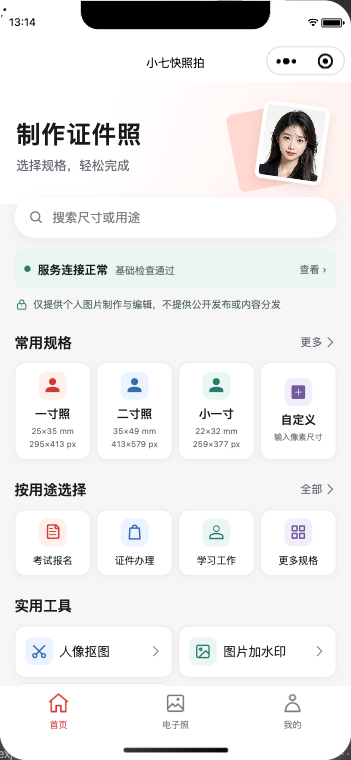
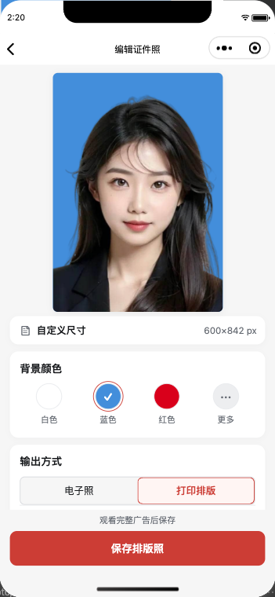
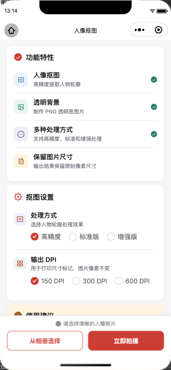
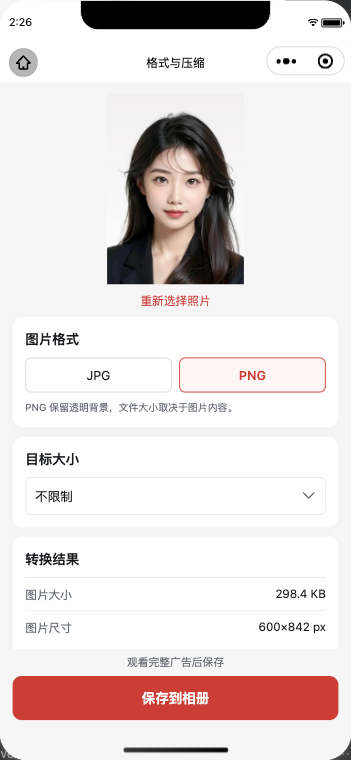
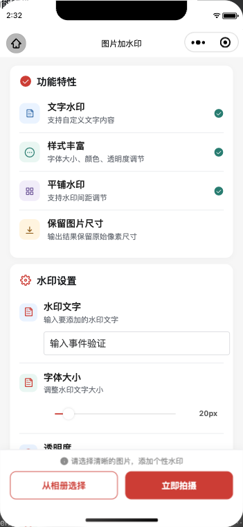
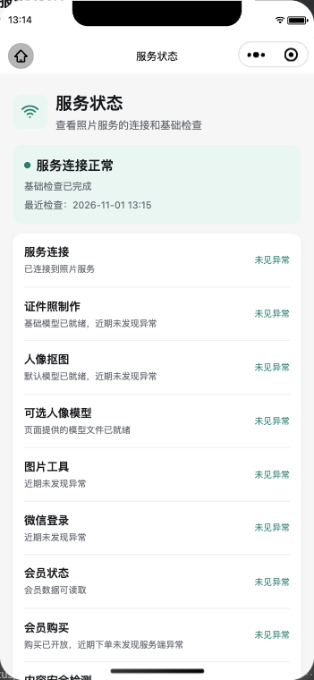

<div align="center">

# 小七快照拍

**证件照制作、图片处理与会员运营的一体化微信小程序**

[](LICENSE)
[](https://uniapp.dcloud.io/)
[](https://v2.vuejs.org/)
[](https://www.typescriptlang.org/)

[界面展示](#界面展示) · [功能介绍](#功能介绍) · [快速开始](#快速开始) · [管理后台](#管理后台) · [项目结构](#项目结构)

</div>

---

## 项目简介

小七快照拍是一个面向个人用户的照片制作工具。用户可以选择证件照规格，通过拍摄或相册导入照片，完成裁剪、背景处理、排版、水印、格式转换和压缩。

仓库包含微信小程序、基于 [HivisionIDPhotos](https://github.com/Zeyi-Lin/HivisionIDPhotos) 的图片处理服务，以及会员、支付和运营管理后台。项目用于个人图片制作与编辑，不提供用户内容公开发布、社区互动或内容分发。

## 界面展示

<table>
  <tr>
    <td align="center"><b>首页与规格选择</b></td>
    <td align="center"><b>证件照编辑</b></td>
    <td align="center"><b>人像抠图</b></td>
  </tr>
  <tr>
    <td></td>
    <td></td>
    <td></td>
  </tr>
  <tr>
    <td align="center"><b>格式转换与压缩</b></td>
    <td align="center"><b>文字水印</b></td>
    <td align="center"><b>服务状态</b></td>
  </tr>
  <tr>
    <td></td>
    <td></td>
    <td></td>
  </tr>
</table>

截图来自微信开发者工具中的开发版，部分页面使用项目自带示例人像。套餐、服务状态和页面显示以实际部署为准；开发版界面不代表已通过微信审核或正式发布。

## 功能介绍

### 照片制作与图片工具

- **证件照制作**：选择常用规格或自定义尺寸，支持人像分割、背景替换、电子照和打印排版照。
- **拍摄辅助**：统一的拍摄界面提供可开关的人像和眼部参考线，支持前后摄像头切换、预览和重拍。
- **人像抠图**：提取人物轮廓，支持不同处理方式并输出透明背景图片。
- **文字水印**：自定义文字、颜色、大小、透明度、角度和间距。
- **格式与压缩**：转换 JPG / PNG，并尝试按所选目标控制文件大小。
- **电子照与分享**：管理已保存的电子照，并通过微信分享小程序入口。

### 会员与支付

- 普通用户按页面提示观看激励视频广告后保存；有效会员保存时免广告。
- 会员采用单次购买，不自动续费；有效期按自然月计算，未到期续费时长叠加。
- 首次初始化的套餐示例为 **1 个月 ¥12、3 个月 ¥24、12 个月 ¥68**。套餐可在后台调整，实际价格和上架状态以购买页面为准。
- 接入微信虚拟支付，提供订单查询、订单详情和退款申请入口；支付能力需要完成微信平台配置。iPhone 支付需满足微信及 Apple 的相关条件。

### 内容安全与服务状态

- 内容安全默认开启：照片进入处理流程前调用微信图片内容安全接口，文字水印在渲染前进行文本检测。检测不通过或服务不可用时会停止相应处理。
- **我的 → 服务状态**提供图片、文字和异步媒体检测演示。异步媒体接口先返回受理结果，最终判定通过微信消息推送回调接收。
- 小程序和管理后台可查看照片服务、会员服务等运行状态。状态页展示基础配置与近期异常，并不代表第三方支付或每次图片处理一定成功。

## 管理后台

管理后台用于日常运营和问题处理，包含：

| 模块 | 主要能力 |
| --- | --- |
| 运营概览与服务监控 | 查看用户、会员、订单及服务状态，检查本机服务与公网连接 |
| 用户与会员 | 通过会员编号查找用户，查看权益流水，按自然月延长或调整到期时间 |
| 会员套餐 | 新建、编辑、排序、归档套餐；核对微信商品后上架 |
| 订单与退款 | 查询订单和退款申请，按支付渠道处理退款并记录核对结果 |
| 审计记录 | 查看后台重要操作记录 |

后台可对符合条件的普通虚拟支付订单发起退款；Apple 内购退款按 Apple 的流程处理。经核实全额退款后，系统会回收该订单尚未使用的会员权益；部分退款及无法安全计算的情况需要人工核对。退款流程与部署注意事项见 [后端说明](backend/README.md#定位用户与处理退款申请)。

默认本地后台地址为 `http://127.0.0.1:8091/`。如需公网访问，应配置 Cloudflare Tunnel、Cloudflare Access 和后台账号密码；当前部署与配置说明见 [后台公网访问](backend/README.md#后台公网访问)。

## 快速开始

### 环境要求

- Node.js 和 npm 或 Yarn
- Python 3.10–3.13
- 微信开发者工具及可用的小程序 AppID
- 微信小程序服务端凭据；如需会员支付，还需完成微信虚拟支付、商品和消息推送配置

### 1. 获取代码并安装前端依赖

```bash
git clone https://github.com/qiqichaoiwan/id-photo.git
cd id-photo
yarn install
```

也可使用 `npm install` 安装前端依赖。

### 2. 配置并启动后端

```bash
cd backend
./bootstrap.sh
./configure.sh
./start-all.sh
```

`bootstrap.sh` 会创建 Python 环境、安装依赖并下载模型权重。`configure.sh` 交互式配置微信和后台所需的本机密钥。请不要将密钥、数据库或本地配置提交到仓库。`start-all.sh` 会占用当前终端；可另开终端继续配置前端，按 `Ctrl-C` 停止本次启动的服务。

启动后默认提供图片 API（`127.0.0.1:8080`）、管理后台（`127.0.0.1:8091`）和微信消息推送服务（`127.0.0.1:8092`）。如需使用 HivisionIDPhotos 原有的 Gradio 界面，可运行 `./start-gradio.sh`。详细配置、支付沙箱和模型说明见 [backend/README.md](backend/README.md)。

### 3. 配置小程序

从仓库根目录复制配置模板：

```bash
cp .env.example .env.local
```

在 `.env.local` 中配置自己的服务域名和激励视频广告位 ID，例如：

```dotenv
VUE_APP_API_BASE_URL=https://your-api-domain.example
VUE_APP_REWARDED_VIDEO_AD_UNIT_ID=adunit-your-id
```

也可分别设置 `VUE_APP_API_DEVELOPMENT`、`VUE_APP_API_TRIAL`、`VUE_APP_API_RELEASE`。未设置时，项目使用 `src/config.ts` 中的默认域名。将 `src/manifest.json` 的 `mp-weixin.appid` 改为自己的 AppID，并在微信公众平台配置对应的合法服务器域名。

### 4. 开发与构建

```bash
# 开发版：使用微信开发者工具打开 dist/dev/mp-weixin
yarn dev:mp-weixin

# 发布构建：使用微信开发者工具打开 dist/build/mp-weixin
yarn build:mp-weixin
```

在微信开发者工具中导入对应目录后，可预览、上传代码并在微信公众平台提交审核。相机、广告、登录和支付能力需结合真实设备、微信平台配置及网络环境使用。

## 项目结构

```text
id-photo/
├── src/
│   ├── api/                   # 照片、会员与内容安全接口
│   ├── components/            # 相机、加载状态等公共组件
│   ├── pages/                 # 首页、图片工具、会员、服务状态等页面
│   ├── model/                 # 证件照规格、颜色和数据类型
│   ├── static/                # 图标与示例图片
│   ├── utils/                 # 请求、广告、图片和本地存储工具
│   └── config.ts              # 服务地址与广告位配置
├── backend/
│   ├── hivision-core/         # HivisionIDPhotos 上游源码
│   ├── hivision-overlay/      # 图片 API、微信登录、会员、支付及后台
│   └── README.md              # 后端配置、运行与运维说明
├── docs/                      # 设计、界面截图与实施文档
├── scripts/                   # 构建辅助与本机服务恢复脚本
├── .env.example               # 前端配置模板
└── README.md
```

## 常用接口

以下接口由本项目后端提供；图片与会员接口按部署配置要求微信登录鉴权。接口详情请参考 [后端说明](backend/README.md) 和 `backend/hivision-overlay/` 中的实现。

| 接口 | 用途 |
| --- | --- |
| `POST /auth/wechat` | 微信登录 |
| `POST /idphoto` | 生成证件照 |
| `POST /human_matting` | 人像抠图 |
| `POST /add_background` | 图片背景处理 |
| `POST /generate_layout_photos` | 生成打印排版照 |
| `POST /watermark` | 添加文字水印 |
| `POST /convert_image` | 图片格式转换与压缩 |
| `GET /service-status` | 查询服务状态 |
| `POST /content-security/image` | 图片内容安全检测演示 |
| `POST /content-security/text` | 文本内容安全检测演示 |
| `POST /content-security/media` | 异步媒体内容安全检测演示 |

## 许可证与致谢

本项目使用 [MIT License](LICENSE)。仓库包含的 HivisionIDPhotos 上游代码遵循其 [Apache-2.0 许可证](backend/LICENSE-HIVISION-APACHE-2.0)；上游模型及其他依赖的使用条件请以各自许可为准。

感谢 [HivisionIDPhotos](https://github.com/Zeyi-Lin/HivisionIDPhotos)、[uni-app](https://uniapp.dcloud.io/)、[Vue.js](https://vuejs.org/) 和 [uView UI](https://www.uviewui.com/) 等开源项目。

<details>
<summary>关注与支持</summary>

<table>
  <tr>
    <td align="center"><b>关注公众号</b></td>
    <td align="center"><b>支付宝支持</b></td>
    <td align="center"><b>微信支持</b></td>
  </tr>
  <tr>
    <td></td>
    <td></td>
    <td></td>
  </tr>
</table>

</details>
