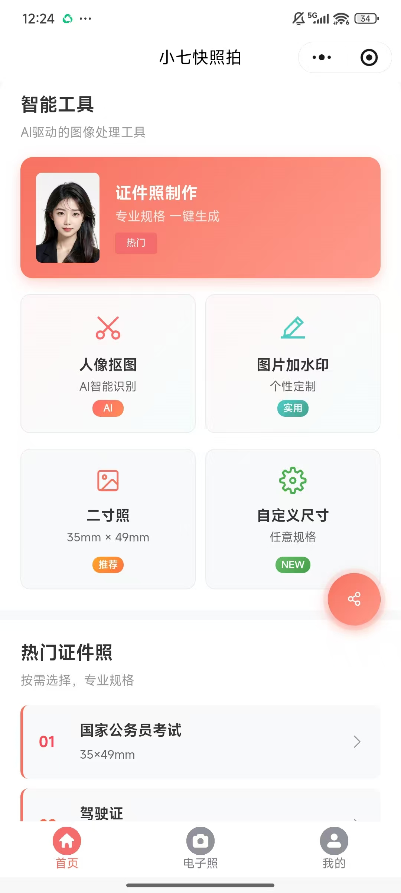
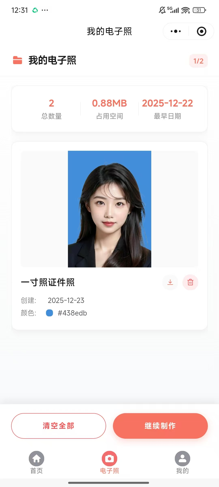
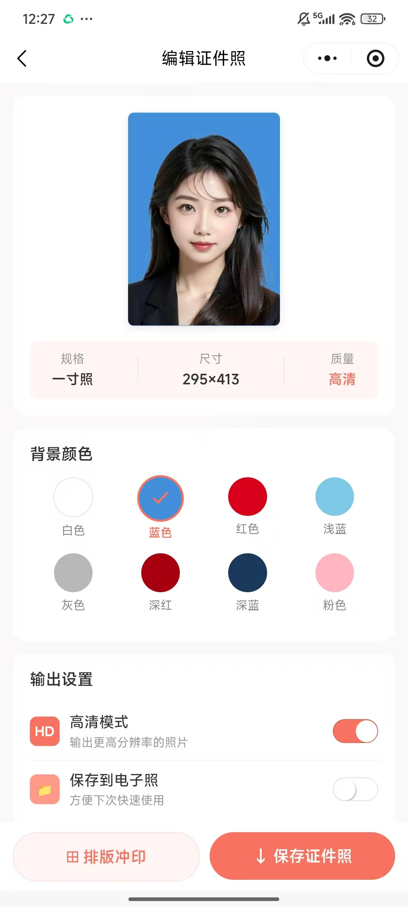
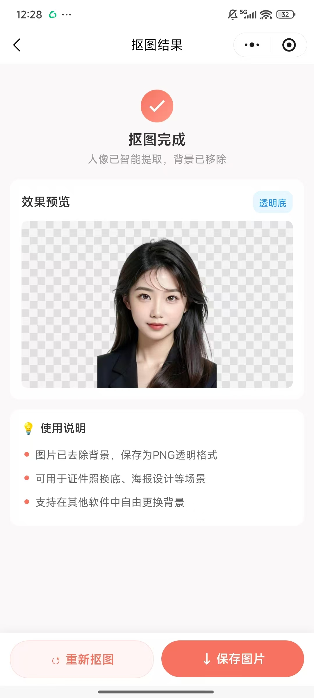
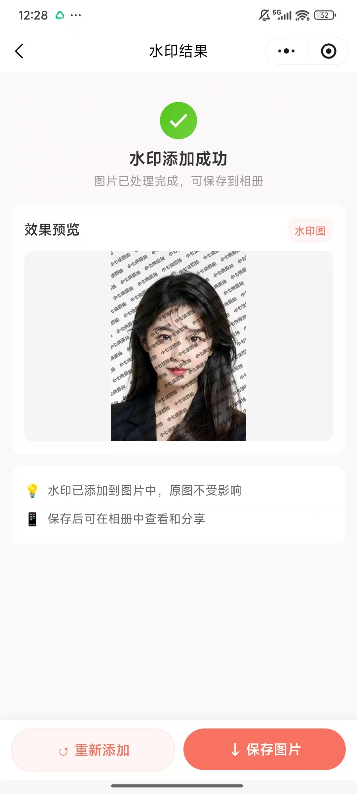
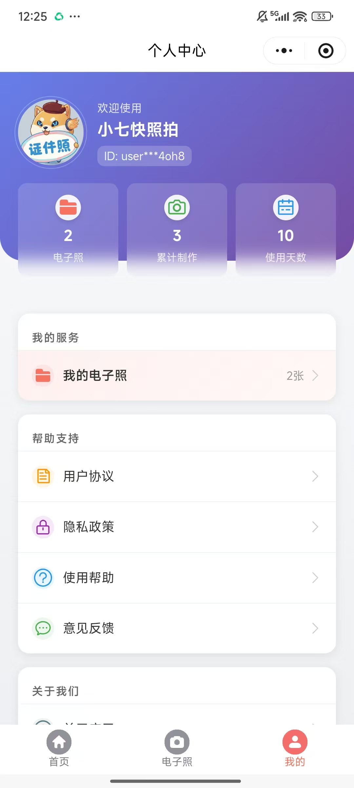

<div align="center">

# 📷 小七快照拍

**一款基于 AI 的智能证件照制作微信小程序**

[](LICENSE)
[](https://uniapp.dcloud.io/)
[](https://vuejs.org/)
[](https://www.typescriptlang.org/)

[功能介绍](#-功能特性) • [快速开始](#-快速开始) • [项目结构](#-项目结构) • [部署指南](#-部署指南) • [常见问题](#-常见问题)

</div>

---

## 📖 项目简介

**小七快照拍** 是一款基于 [HivisionIDPhotos](https://github.com/Zeyi-Lin/HivisionIDPhotos) 开源算法的智能证件照制作微信小程序。通过 AI 技术实现人像智能抠图、背景替换、证件照生成等功能，让用户在手机上就能轻松制作标准证件照。

### 🎯 为什么选择小七快照拍？

- **🤖 AI 智能抠图** - 基于深度学习的人像分割算法，精准识别人物轮廓
- **� 标准规格** - 内置多种标准证件照尺寸，满足各类证件需求
- **🎨 多彩背景** - 支持白、蓝、红等多种标准背景色一键切换
- **📱 便捷操作** - 无需专业技能，拍照即可生成专业证件照
- **💰 完全免费** - 开源项目，可自行部署使用

## ✨ 功能特性

### 🎫 证件照制作

- ✅ 支持一寸、二寸、小一寸、小二寸等标准规格
- ✅ 自定义证件照尺寸（宽度、高度、DPI）
- ✅ 智能人像抠图与背景替换
- ✅ 8种常用背景色（白、蓝、红、浅蓝、灰、深红、深蓝、粉色）
- ✅ 高清/标清双模式输出
- ✅ 六寸排版照生成（用于冲印）

### 🖼️ 图像处理

- ✅ **人像抠图** - AI 智能分离人物与背景，输出透明底PNG
- ✅ **图片水印** - 添加自定义文字水印，支持调节大小、透明度、角度
- ✅ **图像压缩** - 智能调整文件大小，满足各平台上传要求
- ✅ **内容安全识别** - 图片处理前调用微信内容安全接口，服务状态页可查看真实检测结果

### 📋 其他功能

- ✅ 电子照管理 - 保存常用证件照，方便随时使用
- ✅ 激励视频广告 - 支持微信激励广告变现
- ✅ 分享功能 - 支持分享到好友和朋友圈

## 🖥️ 效果预览

<div align="center">
<table>
<tr>
<td align="center"><b>首页</b></td>
<td align="center"><b>电子照</b></td>
<td align="center"><b>证件照编辑</b></td>
<td align="center"><b>人像抠图</b></td>
<td align="center"><b>图片加水印</b></td>
<td align="center"><b>个人中心</b></td>
</tr>
<tr>
<td></td>
<td></td>
<td></td>
<td></td>
<td></td>
<td></td>
</tr>
</table>
</div>

> 📸 截图待补充，欢迎提交 PR

## 🛠️ 技术栈

| 技术                                            | 说明       | 版本     |
| --------------------------------------------- | -------- | ------ |
| [UniApp](https://uniapp.dcloud.io/)           | 跨平台开发框架  | 2.x    |
| [Vue.js](https://vuejs.org/)                  | 前端框架     | 2.6.x  |
| [TypeScript](https://www.typescriptlang.org/) | 类型安全     | 4.x    |
| [Vuex](https://vuex.vuejs.org/)               | 状态管理     | 3.x    |
| [uView UI](https://www.uviewui.com/)          | UI 组件库   | 2.0.36 |
| [Sass/SCSS](https://sass-lang.com/)           | CSS 预处理器 | -      |

### 后端服务

本项目后端采用 **[HivisionIDPhotos](https://github.com/Zeyi-Lin/HivisionIDPhotos)** 开源项目，这是一个轻量级的 AI 证件照制作算法，具有以下特点：

- 🚀 轻量级部署，支持 CPU 推理
- 🎯 高精度人像分割
- 📐 标准证件照尺寸裁剪
- 🎨 智能背景色替换
- 📦 支持 Docker 一键部署

> 感谢 [@Zeyi-Lin](https://github.com/Zeyi-Lin) 提供的优秀开源算法！

## 📁 项目结构

```
src/
├── api/                    # API 接口定义
│   ├── matting.ts         # 人像抠图接口
│   ├── photo.ts           # 证件照生成接口
│   ├── photo-enhanced.ts  # 增强功能接口
│   └── watermark.ts       # 水印处理接口
├── assets/                # 静态资源（样式）
├── components/            # 公共组件
│   ├── LoadingOverlay.vue # 加载动画组件
│   └── ShareButton.vue    # 分享按钮组件
├── config.ts              # 项目配置（API地址、广告ID等）
├── enums/                 # 枚举定义
├── model/                 # 数据模型/类型定义
│   ├── Colors.ts          # 背景色配置
│   ├── Interfaces.ts      # 接口定义
│   ├── PhotoSize.ts       # 证件照尺寸
│   └── size.json          # 尺寸规格数据
├── pages/                 # 页面文件
│   ├── index/             # 首页（尺寸选择）
│   ├── photo/             # 证件照（拍照、编辑）
│   ├── electronic/        # 电子照管理
│   ├── matting/           # 人像抠图
│   ├── watermark/         # 图片水印
│   ├── mine/              # 个人中心
│   ├── user-agreement/    # 用户协议
│   └── privacy-policy/    # 隐私政策
├── static/                # 静态资源（图片）
├── store/                 # Vuex 状态管理
└── utils/                 # 工具函数
    ├── electronic-photo.ts # 电子照管理
    ├── request.ts         # 网络请求封装
    └── storage.ts         # 本地存储管理
```

## 🚀 快速开始

### 环境要求

- Node.js >= 14.0.0
- yarn 或 npm
- 微信开发者工具
- HivisionIDPhotos 后端服务

### 1. 克隆项目

```bash
git clone https://github.com/yang199462/id-photo.git
cd id-photo
```

### 2. 安装依赖

```bash
# 推荐使用 yarn
yarn install

# 或使用 npm
npm install
```

### 3. 配置项目

修改 `src/config.ts` 中的配置：

```typescript
// API 服务地址（你的 HivisionIDPhotos 后端地址）
const baseApi: { [key: string]: EnvironmentConfig } = {
  development: {
    host: "https://your-api-domain.com",  // 修改为你的API地址
  },
  production: {
    host: "https://your-api-domain.com",
  },
};

// 微信激励广告配置（可选）
export const adConfig = {
  rewardedVideoAdUnitId: 'your-ad-unit-id'  // 你的广告单元ID
};
```

修改 `src/manifest.json` 中的微信小程序 AppID。

### 4. 启动开发

```bash
# 微信小程序开发
yarn dev:mp-weixin

# H5 开发
yarn serve
```

使用微信开发者工具打开 `dist/dev/mp-weixin` 目录即可预览。

### 5. 构建发布

```bash
# 构建微信小程序
yarn build:mp-weixin

# 构建 H5
yarn build:h5
```

## 📦 部署指南

### 后端部署（HivisionIDPhotos）

本项目的微信登录、会员、支付回调和管理后台已与 HivisionIDPhotos 源码一起整合到 [`backend/`](backend/)。下载仓库后运行 `cd backend && ./bootstrap.sh && ./configure.sh && ./start-all.sh` 即可准备和启动完整后端；模型权重会在 bootstrap 阶段按固定地址和 SHA-256 自动下载。详细说明见 [backend/README.md](backend/README.md)。

推荐先使用仓库自带的后端启动器：

```bash
# 准备 Python 依赖和 HivisionIDPhotos 模型
cd backend
./bootstrap.sh

# 交互式写入本机微信密钥、支付配置和后台密码
./configure.sh

# 启动图片 API、支付消息接收和后台
./start-all.sh
```

完整部署文档见：[backend/README.md](backend/README.md)。`backend/hivision-core` 保留了 HivisionIDPhotos 的 Gradio 界面和原始 API 源码；本项目实际使用的带鉴权、会员和支付能力的入口是 `backend/hivision-overlay/deploy_api.py`。上游 Docker 镜像只包含基础 HivisionIDPhotos，不能替代本项目后端。

### 前端部署

1. 执行 `yarn build:mp-weixin` 构建项目
2. 使用微信开发者工具打开 `dist/build/mp-weixin` 目录
3. 点击"上传"提交到微信公众平台
4. 在微信公众平台提交审核

## 🔧 API 接口说明

项目使用的 HivisionIDPhotos API 接口：

| 接口                        | 方法   | 说明           |
| ------------------------- | ---- | ------------ |
| `/idphoto`                | POST | 生成证件照（抠图+裁剪） |
| `/human_matting`          | POST | 人像抠图（仅抠图）    |
| `/add_background`         | POST | 添加/更换背景色     |
| `/generate_layout_photos` | POST | 生成六寸排版照      |
| `/set_kb`                 | POST | 设置图片文件大小     |

详细接口文档：[HivisionIDPhotos API 文档](https://github.com/Zeyi-Lin/HivisionIDPhotos/blob/master/docs/api_CN.md)

## ❓ 常见问题

<details>
<summary><b>Q: 如何修改证件照规格？</b></summary>

编辑 `src/model/size.json` 文件，按照现有格式添加新的规格：

```json
{
  "name": "规格名称",
  "pxWidth": 295,
  "pxHeight": 413,
  "mmWidth": 25,
  "mmHeight": 35
}
```

</details>

<details>
<summary><b>Q: 如何添加新的背景色？</b></summary>

编辑 `src/pages/photo/edit.vue` 中的 `colorConfig` 数组：

```typescript
const colorConfig = [
  { name: '颜色名称', color: '#HEX颜色值' },
  // ...
]
```

</details>

<details>
<summary><b>Q: 如何关闭广告功能？</b></summary>

在相关页面中，将 `showRewardedVideoAd()` 方法的返回值改为直接返回 `true`，或删除广告相关代码。

</details>

<details>
<summary><b>Q: 编译报错 "multiple default exports"？</b></summary>

这是 IDE 的误报（vue-property-decorator 的问题），不影响实际编译和运行。

</details>

## 🤝 贡献指南

欢迎提交 Issue 和 Pull Request！

1. Fork 本仓库
2. 创建特性分支 (`git checkout -b feature/AmazingFeature`)
3. 提交更改 (`git commit -m 'feat: 添加某个功能'`)
4. 推送到分支 (`git push origin feature/AmazingFeature`)
5. 开启 Pull Request

### 提交规范

- `feat:` 新功能
- `fix:` 修复问题
- `docs:` 文档更新
- `style:` 代码格式调整
- `refactor:` 代码重构
- `chore:` 构建/工具变动

## 📄 开源协议

本项目采用 [MIT](LICENSE) 开源协议。

## 💖 支持项目

如果这个项目对你有帮助，欢迎：

- ⭐ 给项目点个 Star
- 🐛 提交 Issue 反馈问题
- 🔀 提交 PR 贡献代码
- 📢 分享给更多人

---

### 🔗 关注与支持

<table width="100%">
  <tr>
    <td width="33%" align="center"><b>关注公众号</b></td>
    <td width="33%" align="center"><b>扫码支持(支付宝)</b></td>
    <td width="33%" align="center"><b>扫码支持(微信)</b></td>
  </tr>
  <tr>
    <td width="33%" align="center"></td>
    <td width="33%" align="center"></td>
    <td width="33%" align="center"></td>
  </tr>
  <tr>
    <td width="33%" align="center">获取最新动态</td>
    <td width="33%" align="center">请作者喝杯咖啡 ☕</td>
    <td width="33%" align="center">请作者喝杯咖啡 ☕</td>
  </tr>
</table>

---

## 🙏 致谢

- [HivisionIDPhotos](https://github.com/Zeyi-Lin/HivisionIDPhotos) - 优秀的 AI 证件照生成算法
- [UniApp](https://uniapp.dcloud.io/) - 跨平台开发框架
- [uView UI](https://www.uviewui.com/) - 优秀的 UI 组件库
- [Vue.js](https://vuejs.org/) - 渐进式 JavaScript 框架

---

<div align="center">

**如果觉得项目不错，请给个 ⭐ Star 支持一下！**

Made with ❤️ by [小七快照拍](https://github.com/yang199462/id-photo.git)


